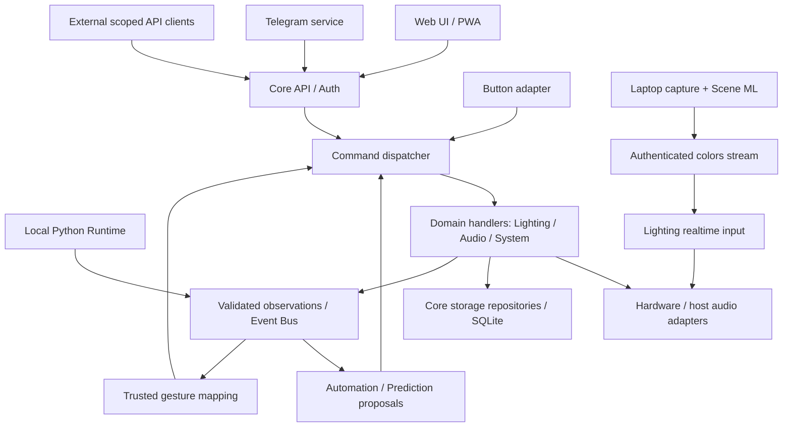

# Архитектура v0 — результат Дня 3

**Hardware baseline от26.10.2026: только Raspberry Pi 4B с2GB RAM.** [Ресурсный профиль](../development/pi4b-2gb.md). Pi совместные memory/performance gates ещё не выполнены.

Дата: 25 октября 2026 года. Основание: [ТЗ v1.0](../../Smart_Home_Hub_TZ.md), [матрица требований](../requirements.md), [аппаратная проработка](../DAY_002_RESULT.md).

Здесь приняты **рабочие проектные решения для реализации**, а не заявлена готовность системы. Их можно изменять последующим ADR с причиной и влиянием на контракты. Изменения обязательного объёма ТЗ не приняты. Параметры, выбранные в этих документах дополнительно к ТЗ, помечены проектными defaults. Конкретные библиотеки, drivers, версии ОС и модели ML здесь не выбираются.

## Документы

| Документ | Что определяет |
|---|---|
| [domain-model.md](domain-model.md) | Сущности, поля, связи, владельцы и инварианты |
| [data-model-v0.md](data-model-v0.md) | Логическая схема SQLite, runtime-only данные, retention и transaction boundaries |
| [commands.md](commands.md) | Общий путь команды, auth/scopes, arbitration, concurrency, idempotency и результаты |
| [events.md](events.md) | Event envelope, каталог, delivery/backpressure, WS и privacy |
| [state-machines.md](state-machines.md) | Startup/ready/degraded/Safe Mode, zones/devices/audio/camera/screen/overrides |
| [scenarios.md](scenarios.md) | Проверка контрактов на конфликтных и аварийных сценариях |
| [examples/commands.json](examples/commands.json) | Синтетические примеры внутреннего command envelope, без secrets |
| [examples/events.json](examples/events.json) | Синтетические event envelopes, не runtime history |
| [examples/readiness.json](examples/readiness.json) | Нормальный, degraded и Safe Mode snapshots |

## Архитектурные решения

| ADR | Решение | Статус |
|---|---|---|
| [ADR-001](adr/001-module-boundaries.md) | Модули, права на hardware/storage и единый command layer | Принято как проектное решение; проверка в реализации |
| [ADR-002](adr/002-command-arbitration.md) | Scoped manual override, приоритеты, сериализация и delayed jobs | Принято как проектное решение; проверки Д032/Д101–Д110 |
| [ADR-003](adr/003-camera-lifecycle.md) | Один camera owner, независимые consumer permissions, CV indicator | Принято как проектное решение; аппаратная проверка Д081–Д100 |
| [ADR-004](adr/004-readiness.md) | Critical readiness отдельно от degraded и release-profile smoke | Принято как проектная интерпретация §36/38; проверка Д013/Д142 |
| [ADR-005](adr/005-sqlite-safe-mode.md) | Защищённый локальный emergency control без SQLite | Принято как проектное решение; проверка Д128 |
| [ADR-006](adr/006-config-data-ownership.md) | Env/YAML/SQLite, privacy, habit fields и retention ownership | Принято в части модели; backup erase policy требует реализации |
| [ADR-007](adr/007-led-topology.md) | Зоны независимы от физических каналов; SPI-chain — кандидат | Абстракция принята; физическая topology предварительная до Д004/Д008 |

## Границы системы

Диаграмма упрощает границы. Realtime stream не обходит политику управления: он разрешён только для привязанной зоны, текущей сессии и уже активного AMBILIGHT. Не включает свет и не выбирает режим сам. Sensor/ML observations не являются доверенными commands.

## Проверка завершения Д003

Контракты согласованы между этими документами и проверены разбором сценариев. Продуктовый код, SQLite migrations, network endpoints, simulation tests и HIL ещё не реализованы. Следующий шаг — Д004: подтверждение LED/audio подходов; неопределённое наличие оборудования остаётся блокером фактического эксперимента, а не этих контрактов.

## Прогресс Д011–Д015

После архитектурного этапа реализованы Go Core/config/lifecycle, read-only network endpoints, bounded bus и минимальные simulation adapters. [Фактический результат](../DAYS_011_015_RESULT.md), [реализованный event contract](events.md#реализованный-срез-д014–д015). SQLite/auth/WS/production hardware ещё не реализованы; формулировки раздела Д003 выше описывают состояние на момент его завершения.
