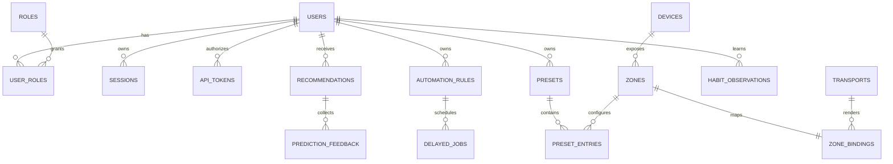

# Логическая схема данных v0

Это исходная логическая модель перед migrations Д016/Д021, включающая будущие сущности. Реализованный SQL schema7 и границы repositories: [фактический словарь Д021](../storage/data-dictionary.md). SQLite WAL задаёт ТЗ. Связи: [domain](domain-model.md), [commands](commands.md), [ADR-006](adr/006-config-data-ownership.md).

## 1. Ownership и связи

Только Core storage layer открывает SQLite. Domain modules работают через узкие repositories и unit-of-work; Python Runtime, bot, screen-client, browser, MQTT devices не монтируют БД. DB migrations и backup/restore принадлежат System/Storage, а не frontend.

ER показывает только основные связи, не все nullable/system-owned entities. Shared devices/transport config системные, ownership presets/rules/habits — пользовательский. Удаление user не должно каскадно отключать питание/стереть hardware config без отдельного domain workflow.

## 2. Таблицы и ограничения

| Table / PK | Основные FK / поля | Индексы / constraints | Кто пишет |
|---|---|---|---|
| users / id | username, password_hash, enabled, timezone | UNIQUE normalized username | Auth |
| roles / id, user_roles / user_id+role_id | FK users/roles | UNIQUE role name; composite PK | Auth |
| sessions / id_hash | user_id, expires_at, revoked_at | user_id, expires_at; никаких raw cookies | Auth |
| service_principals / id | owner_user_id nullable, kind, enabled | kind/id | Auth/System |
| api_tokens / id | principal_id/user_id, secret_hash, scopes, bindings, revoked_at | UNIQUE secret_hash; owner lookup | Auth |
| pairing_requests / id | code_hash, requested binding, expires_at, consumed_at, attempts | expires_at; code hash unique среди active | Auth/Devices |
| telegram_links / telegram_user_id | user_id, enabled | user_id; uniqueness policy один Telegram ID→один user | Auth integration |
| devices / id | type, adapter_id, metadata, configured_enabled | capabilities typed; status runtime отдельно | Device Manager |
| transports / id | adapter kind, channel ref, capacity, hardware_config_ref | hardware config version; no device handles | System/Lighting |
| zones / id | device_id, owner nullable, desired fields, revision | finite ranges, supported mode | Lighting |
| zone_bindings / zone_id | transport_id, offset/count, layout mapping | bounds/non-overlap проверять transactionally | Lighting config |
| presets / id, preset_entries / preset_id+zone_id | owner_user_id, zone fields | revision, foreign references | Lighting settings |
| automation_rules / id | owner_user_id, versioned DSL, priority, enabled, revision | owner/enabled; JSON schema before write | Automation |
| delayed_jobs / id | rule_id/revision, due_at, guard, trigger_id, status | status+due_at; unique trigger/action identity | Automation |
| manual_overrides / id | principal, paths, created/expires_at, command_id | active scope+expiry | Dispatcher |
| gesture_mappings / user_id+gesture | action template, confirmation/cooldown | permitted commands, typed params | Settings |
| button_mappings / device_id+press_kind | action template | single/double/long allowed | Settings |
| user_settings / user_id+key | value, schema_version, revision | per-key validator, no credentials | Settings repositories |
| habit_learning_state / user_id | started_at, privacy_epoch, model_version, quality | one current generation | Habits |
| habit_observations / id | user_id, timestamp, zone/context/minimal fields | user_id+timestamp; zone+timestamp по запросам | Local collector |
| habit_model_metadata / user_id+version | privacy_epoch, feature version, path/checksum, trained_at | only current epoch publish | Habits/System |
| recommendations / id | user_id, action, confidence, model version, status, expires_at | user_id+status+expires_at | Predictions |
| prediction_feedback / id | recommendation_id, user_id, decision, created_at, privacy_epoch | UNIQUE user_id+recommendation_id; decision immutable | Predictions |
| automation_audit / id | rule/trigger refs, timestamp, action summaries, result/error | timestamp, rule_id+timestamp | Automation |
| command_records / principal_id+command_id | normalized request hash, status, result summary, revision, expiry | no secret/raw payload; in-flight pinned | Dispatcher |
| security_audit / id | time/action/result/principal ref/redacted metadata | timestamp; retention Q-030 | Auth/System |
| schema_migrations / version | checksum, applied_at | monotonic/checksum | Migration runner |

Некоторые contracts могут быть encoded JSON внутри SQLite: это не разрешение хранить произвольную невалидированную структуру. SQL foreign_keys включены; миграции определяют explicit deletion policy. Delete rule сначала cancel jobs и сохранить audit summary, а не потерять audit по cascade. Audit хранит безопасный snapshot имени/ID, чтобы deletion rule не делал старые entries бессмысленными.

## 3. Что только в RAM

Camera frames, screen frames, PCM buffers, FFT/spectrum/beat history, scene labels history, Ambilight frames, current track metadata, hardware handles, WS subscriptions, camera leases/current-boot arm, live presence evidence и current SensorMeasurement cache.

Persisted zone last state — logical settings, не RGB history. UI preview формируется из current RAM frame. Никакой generic `events(payload)` table с camera/screen/DSP payload не вводится. Метрики/ошибки используют allowlisted scalar summaries; JSON logging не сериализует memory buffers.

## 4. Commit и физический эффект

Control admission валидирует auth/policies/revision. При доступной БД transaction сохраняет desired settings + manual override, если нужен + command record ACCEPTED. Audit обязательного durable action записывается владельцем в соответствующую transaction/следующую outcome transaction, а не зависит от delivery Event Bus. Hardware I/O делается после commit вне write transaction; успешный результат отмечается отдельной outcome transaction и applied state.

Crash после commit до hardware reconciles absolute desired state. Crash после отправки NextTrack до known outcome оставляет UNKNOWN_OUTCOME: automatic replay не выполняется. Во время shutdown fade OFF — transient effect, **не** update desired mode в OFF, иначе last state из §36 теряется. При рестарте восстанавливается desired mode, для отсутствующего live source применяется fallback.

Multi-action не становится distributed transaction. Desired state changes проходят согласованную admission; runtime effects могут быть PARTIAL, per-action status обязателен. Корректный SQLite commit не доказывает, что физическая лента получила сигнал.

## 5. Retention

| Данные | Policy v0 |
|---|---|
| Habit observations | Rolling 90 календарных дней; UTC cutoff, user timezone только feature |
| Automation audit | 30 дней |
| Feedback / recommendation features | Не дольше привязанного разрешённого learning window; cleanup не оставляет model training references к удалённым private inputs |
| Models | Local artifacts; current model обучается только на допустимом window; после cutoff требуется refresh/invalidation, чтобы старые данные не сохранялись бесконечно в модели |
| Completed command records | Проектные 24 часа idempotency metadata; pending/delayed не удалять до resolution |
| Sessions/pairing | Expiry/revoke cleanup по auth contract, exact defaults Д018–Д020 |
| Security logs/audit | Конечный настраиваемый срок, точные числа остаются Q-030; unlimited retention не использовать |
| Backups | Daily, последние 7; не public artifacts; privacy delete отдельно ниже |

Confidence/quality при insufficient data не подменяются синтетическими real observations. Minimal habit fields volume/presence/ambient/origin добавлены проектно, потому что иначе §17.2/17.5 не обеспечены §17.1. `tv_active` первоначально — явный nullable signal из screen activity, не обещание отдельной телевизионной интеграции; его точное происхождение Q-022.

## 6. Delete learning history, backup и concurrent training

Удаление повышает `privacy_epoch`, останавливает training jobs, удаляет observations/feedback/recommendations/model metadata и artifacts/caches текущего пользователя, выставляет новый started_at. Worker может опубликовать модель только если его captured epoch всё ещё current: старый training не возвращает удалённые данные.

Backup содержит user data, поэтому delete не заканчивается одной SQL DELETE. Проектная policy: удалить доступные Hub-managed backup copies со старой learning history, затем создать новый clean recovery point, не обещая сохранить семь копий немедленно после privacy purge. Внешние exports, недоступные Hub, перечислить пользователю; автоматическое удаление с внешних носителей не обещать.

Чтобы старый экспорт при restore не отменял delete, хранить local privacy-epoch tombstone вне application DB в защищённом system volume, исключённом из обычного restore. Restore со старым epoch запускается только в maintenance и вычищает learning state до re-enable. Factory reset увеличивает global reset generation, очищает managed data/backups/accesses и оставляет только non-user tombstone поколений; точный filesystem/backup implementation проверить Д118/Д129–Д130. Если tombstone утрачен вместе с носителем, automatic detection старого внешнего backup не гарантируется: restore должен явно требовать выбора discard learning data по default.

## 7. Config ownership

Env: secrets и explicit infrastructure overrides (`DATABASE_PATH`, service credentials), без logs. YAML: host/bus/pins/transport/safety limits/endpoints/defaults. SQLite: user runtime preferences/presets/rules/mappings. Один ключ имеет одного владельца; не объединять всё слепой цепочкой env>YAML>DB.

Для разрешённых infrastructure keys документировать whitelist precedence env override→YAML→built-in development default. Production secret без значения — startup error. Persisted user setting→validated YAML default→built-in безопасный default. Наличие похожего ключа в env не переписывает user preference. Hardware binding/safety limit change — admin maintenance validation, не горячая запись slider.

Config snapshot имеет revision; apply валидируется целиком, invalid change не меняет половину модулей. Требующие restart настройки явно возвращают RESTART_REQUIRED, а не ложно «применено». В Safe Mode DB writes запрещены; YAML не становится запасной БД для user commands.
