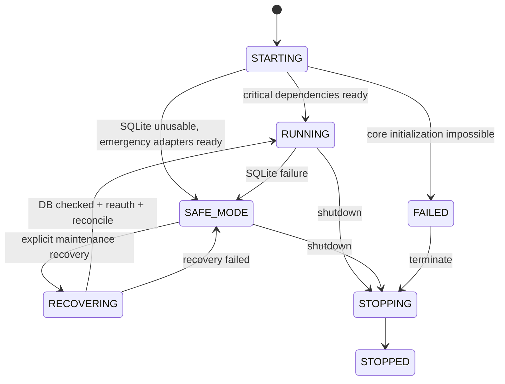
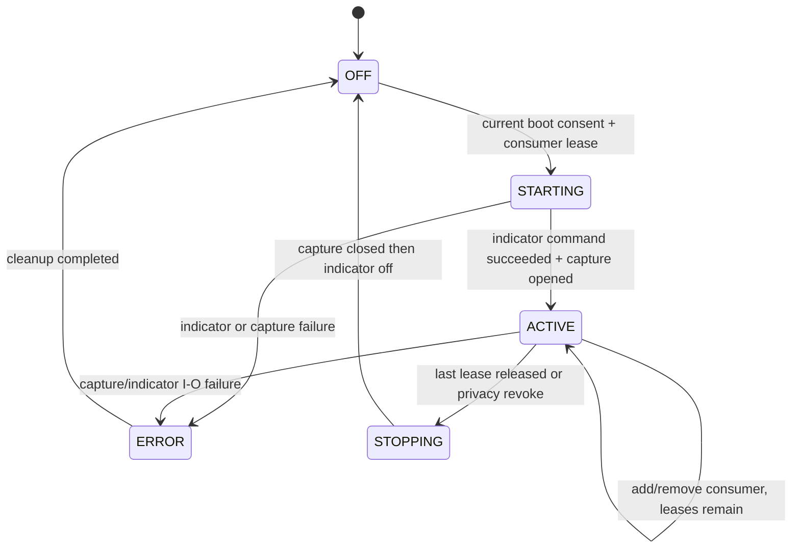

# Словарь состояний и переходы v0

Связь: [domain](domain-model.md), [commands](commands.md), [ADR-003](adr/003-camera-lifecycle.md), [ADR-004](adr/004-readiness.md), [ADR-005](adr/005-sqlite-safe-mode.md).

## 1. System lifecycle и готовность

`degraded` — отдельный health flag, а не конкурирующее lifecycle enum. RUNNING+degraded=true при упавшем ML/MQTT допустим. `/health` 200 при живом работающем control/emergency loop; 503 при провале собственной liveness. `/ready` 200 только при доступном Core command layer, годной SQLite/schema и критических configured hardware control adapters. В Safe Mode `/ready` 503, хотя локальные emergency commands доступны.

Каждая dependency проверяется и отражает enabled/configured/critical/status/reason. Optional/disabled ML, broker, camera, Spotify, Telegram не блокируют baseline manual commands. Неработающий физический LED adapter в production profile может сделать normal readiness false; safe emergency audio, если доступно, не скрывает эту проблему. Simulation profile использует fake critical adapters, не требует наличия Pi.

Release verifier проверяет `/ready`, service versions и smoke всех **обязательных для этого release profile** services. Он не объявляет успешным deployment новой broken ML image только потому, что baseline core ready. Допустимая runtime degradation и успешность установки обязательного сервиса — разные условия. Profile requirements задаются manifest, не произвольным query parameter HTTP клиента.

## 2. Device availability

| Состояние | Условие | Переход |
|---|---|---|
| ONLINE | Adapter initialized, свежая доступность | Offline timeout→OFFLINE; explicit error→ERROR |
| OFFLINE | Не отвечает/отключён | Reconnect + valid handshake/read→ONLINE |
| ERROR | Known adapter/config/read failure | После устранения причины и успешного reinitialize→ONLINE |
| DISABLED | Явно отключён config/admin | Enable→initializing затем ONLINE/OFFLINE/ERROR |

`initializing` — техническая фаза adapter, не пятый persisted status ТЗ. DISABLED не превращается в ONLINE от случайного MQTT state. Availability source TTL/thresholds остаются настройками adapters. Неотвечающий sensor не выдаёт measurement=0.

## 3. Lighting и transport

Desired mode — один из 11 modes; applied mode/fallback/availability отдельны. Команда меняет desired revision, renderer формирует applied revision. Transport frame собирается из всех zones, затем единый limiter.

- AMBILIGHT + valid bound stream/current render epoch → stream colors.
- AMBILIGHT + stream unavailable/inactive → configured fallback, desired mode сохраняется AMBILIGHT.
- Valid stream returns → вернуться к AMBILIGHT только если desired mode всё ещё AMBILIGHT и render epoch разрешает.
- Master OFF → desired OFF всех зон, invalidate render epochs, wildcard override. После override expiry OFF остаётся до новой разрешённой команды; старый stream сам не включает свет.
- Safety limiter/clamp применяется независимо от desired/override/ML. Отсутствие current sensor не означает измеренную гарантию потребления; это оценочная модель.

## 4. Audio и pairing

Playback: STOPPED→PLAYING по explicit Play при доступном source/output; PLAYING→PAUSED по Pause; PAUSED→PLAYING по Play; Stop→STOPPED. BUFFERING/ERROR — технические состояния с reason. Source/output availability отдельно; fallback не вызывает неожиданного autoplay. После любого process restart playback STOPPED, даже если старый desired record говорил PLAYING.

Pairing: CLOSED→OPEN только explicit admin/UI local command; OPEN→CLOSED по expiry/cancel/shutdown. Новый device вне OPEN запрещён. Trusted reconnect — отдельная policy, не открытие нового pairing. На Д003 принят проектный default pairing window 120 секунд, конечная user-configurable TTL; конкретный BlueZ flow/подтверждения и outbound roles остаются Q-009 до Д038.

## 5. Camera lifecycle

Permissions: отдельные `gesture_allowed` и `cv_presence_allowed`. Saved preference не равна active lease. После boot **оба consumers не armed**, capture OFF до явного разрешения пользователем в текущем boot. После arm presence lease может автоматически брать кадр раз в 2–3 секунды; это уже разрешённая потребность. Gesture Mode включает gesture capture, затем activation gesture открывает окно **действий**; activation gesture не может распознаваться при физически выключенном capture.

Индикатор включать перед open/read, держать до release последнего camera buffer/handle, затем выключать. Случай «GPIO write succeeded, LED физически перегорел» без обратной связи определить нельзя: `indicator_commanded_on` не называть VERIFIED_ON. Известная ошибка indicator I/O блокирует capture; реальную видимость проверить HIL. Stronger physical fault detection потребует отдельного hardware feedback и пока не заявлена.

Gesture/camera revoke немедленно invalidates consumer epoch и pending gesture actions. ML reconnect не восстанавливает отозванные permissions. Crash whole process полагается на ограниченные leases/cleanup/watchdog и состояние hardware, не на finally, который может не выполниться.

## 6. Screen session

Connection state и activity разделены:

| Ось | Значения |
|---|---|
| Connection | UNPAIRED/PAIRED_DISCONNECTED/CONNECTED/REVOKED |
| Activity | ACTIVE/STATIC/SCREEN_OFF/UNKNOWN |
| Effective renderer input | VALID/STALE/INACTIVE/DISALLOWED |

One-time pairing→device token; connect создаёт stream epoch. Frame имеет session/sequence/mapping version; older epoch/sequence не применяется. Token revoke→close connection/invalidate epoch/fallback, если желаемый mode AMBILIGHT. Disconnect/timeouts→fallback; exact timing Q-014 на Д065. Static/off detection не означает удаление pairing.

Frame не меняет desired mode и не создаёт manual override. Scene metadata относится к той же привязанной session; не даёт token authority на другую зону.

## 7. Manual override и время

Lifecycle ACTIVE→EXPIRED по TTL, ACTIVE→CLEARED по explicit user action. Valid новое manual intent того же scope заменяет/продлевает lease; retry ID нет. Нормальные expiry/timeouts внутри процесса monotonic. Persisted UTC expiry на restart восстанавливает только оставшееся время, ограниченное исходным TTL; абсолютные UTC deadlines сохраняются.

Если часы после restart недостоверны, не угадывать, что lease истёк: защитить affected scope до синхронизации либо явной user clear. `CLOCK_UNCERTAIN` блокирует schedules/habit AUTO, но manual controls доступны. Backward clock не продлевает работающий monotonic timer, forward jump не сокращает его. Распознавание недостоверных часов/clock tolerance — реализация Д103, без требования обязательного WAN/NTP для каждого старта.

## 8. Presence, rules и jobs

Fusion четыре states по Q-019: валидные положительные evidence→PRESENT/PROBABLY_PRESENT по принятой таблице, уверенное отсутствие→AWAY, отсутствие/противоречивые данные→UNKNOWN. Численные weights/TTL ещё не придуманы. `UNKNOWN` не удовлетворяет `presence==AWAY`; schedule/sensor rule не трактует null как false.

Condition evaluator трёхзначный: TRUE/FALSE/UNKNOWN. AND: FALSE доминирует, иначе UNKNOWN при неизвестном child. OR: TRUE доминирует, иначе UNKNOWN при неизвестном child. Rule исполняется только при TRUE. Дубли trigger dedupe, generated state-change не создаёт бесконечный action loop; lineage/re-entry guard ограничивает повтор того же rule по одной цепочке.

DelayedJob: PENDING→RUNNING→APPLIED/PARTIAL/FAILED; disable/change/override/guard false→CANCELLED; deadline missed→EXPIRED; uncertain external effect→UNKNOWN_OUTCOME. Future jobs после boot восстанавливаются, overdue по default не catch-up. Rule false→true и schedule tick — explicit triggers; простое повторное stale measurement не равно новому подтверждённому событию.

## 9. Habits и delete

Learning state COLLECTING до >=30 реальных дней, затем ELIGIBLE при data quality, иначе INSUFFICIENT_DATA. ELIGIBLE не включает AUTO автоматически: user mode и confidence policy отдельно. Suggestion PENDING→ACCEPTED/REJECTED/EXPIRED; accepted action может FAILED при новом override, feedback accept не обещает успешный effect.

Delete: suspend collector/training→advance privacy_epoch→purge DB/artifacts/caches/managed old backups→new started_at→COLLECTING. Невыполненный purge даёт явный error, не ложный «удалено всё». Старый worker/output отвергается по epoch. Restore соблюдает external tombstone из data model.

## 10. Graceful shutdown и restart

1. STOPPING: прекратить admission обычных commands, закрыть pairing и новые stream sessions.
2. Остановить scheduler/jobs/new inference requests; revoke camera leases.
3. Fade LEDs OFF через safety limiter **без перезаписи saved desired state**.
4. Дождаться bounded in-flight outcomes, записать known/unknown statuses и flush SQLite.
5. Остановить Runtime/adapters, выключить camera indicator после capture release.
6. STOPPED; при timeout использовать documented forced stop и reconciliation на boot.

После boot: desired LED settings восстановить; live modes при отсутствии input получают fallback; music STOPPED; camera OFF; automation engine enabled, но guards/overrides/clock/privacy/Safe Mode по-прежнему действуют. Engine enabled не означает force-enable отключённых пользователем rules и не отменяет Master OFF.
