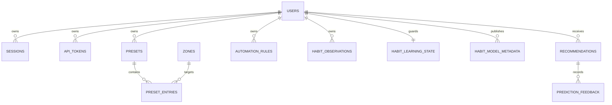

# Фактическая SQLite schema v7

Д021, 28.10.2026. Реализация: `internal/storage/migrations/001_*.sql`–`007_*.sql`.
Этот словарь описывает существующие таблицы; [логическая v0](../architecture/data-model-v0.md)
содержит также будущие сущности. Только Core открывает БД. Pi4B **2 GB RAM**:
один connection, WAL, foreign_keys=ON, synchronous=FULL, immediate transactions,
bounded SQL reads; массовая загрузка dataset в Go/Python не предусмотрена.

Migration007 добавляет global time indexes для bounded retention, не меняя
checksums применённых1–6.

## Новые сущности v4–v6

| Таблица | Поля / ключи | Владелец и жизненный цикл |
|---|---|---|
| sessions | id_hash PK, user_id FK, expires_at, revoked_at; v4: created_at, last_seen_at, csrf_state | User; hash-only cookie, idle30min/absolute12h, cap5; audit вместе с выдачей/отзывом |
| api_tokens | id PK, owner_id FK, secret_hash UNIQUE, name, scopes JSON, bindings JSON, created_at, expires_at, revoked_at | User; raw secret не сохраняется; cap16,90d; own metadata only |
| security_audit | id PK, occurred_at, action, result, principal_id, resource_ref, reason | Allowlisted metadata,30d UTC; own principal cursor API |
| presets | id PK, owner_id FK, name, revision>0 | Typed metadata, optimistic CAS; engine/UI ещё отсутствуют |
| preset_entries | (preset_id,zone_id) PK, mode OFF/STATIC, brightness[0,1] | FK preset CASCADE, FK zone;1..64 entries/repository call |
| automation_rules | id PK, owner_id FK, enabled bool, revision>0, schema_version=1, dsl<=4096 | Strict versioned sensor_threshold/SetZoneState template, records disabled; engine будущий |
| gesture_mappings | (user_id,gesture) PK, command_type, target, cooldown_ms[0,60000], confirmation bool | Known gesture allowlist, owned/shared authorized zone, SetZoneState only |
| button_mappings | (device_id,press_kind) PK, owner_id FK, command_type,target | single/double/long; device/zone FK; owner cannot overwrite another owner's mapping |
| automation_audit | id PK, owner_id FK, rule_ref, occurred_at,result,reason |30d; таблица/retention есть, runtime writer появится с Automation |
| habit_learning_state | user_id PK/FK, started_at, privacy_epoch>0, quality insufficient/eligible | Initial insufficient; epoch guards reject stale workers; collector не включён |
| habit_observations | id PK,user_id FK,occurred_at,timezone,privacy_epoch,zone_id FK,mode,color_rgb?,brightness?,volume?,presence?,ambient_lux?,monitor_active?,origin,quality | Purpose-specific data90d; NULL означает отсутствующее наблюдение, не0/AWAY; owner+epoch+cursor query <=100 |
| habit_model_metadata | (user_id,version) PK,privacy_epoch,checksum,trained_at | SHA256 hex metadata, no actual model blob; old model aging invalidates eligibility |
| recommendations | id PK,user_id FK,privacy_epoch,model_version,confidence,command_type,zone_id FK,mode,color_rgb?,brightness?,volume?,created_at,status,expires_at | Typed proposed SetZoneState; current model/epoch,TTL<=24h; no execution; status pending/accepted/rejected/expired |
| prediction_feedback | (user_id,recommendation_id) PK,privacy_epoch,decision,created_at | FK recommendation CASCADE; immutable accepted/rejected; same decision retry idempotent, changed decision409 |

Time fields — integer Unix seconds UTC. Timezone — validated IANA name, например
Europe/Minsk; учитывается отдельно от UTC cutoff. color_rgb integer0..16777215;
brightness/volume normalized finite0..1; lux finite>=0. Presence enum PRESENT,
PROBABLY_PRESENT, AWAY, UNKNOWN; nullable measurement не превращается в AWAY.
Origin manual/automation/prediction; quality valid/stale/unknown. Время наблюдения
и контекст в fixtures синтетические: collector/training ещё не включены.

## Существующие таблицы v1–v3

Users/roles/user_roles/role_permissions задают enabled state, Argon2id PHC и grants.
Devices/zones — зарегистрированные ресурсы/ownership. User_settings хранит
version/revision для CAS. Command_records — bounded-payload setting outcome/dedupe,
manual_overrides — отдельный policy contract. Bootstrap_state фиксирует одноразовый
bootstrap; auth_attempts — HMAC-keyed account limits; auth_internal — private HMAC key.
Сроки command_records/manual_overrides не изменены этим этапом; глобальный storage
size cap и восстановление из backup не объявляются выполненными.

## Индексы, ограничения и retention

Token owner/expiry, security time/principal-id, automation owner-time,
habit owner-time/owner-id и global retention-time, automation global time, model trained_at, recommendation owner-status-expiry
и created_at покрывают bounded чтение/cleanup. Проверка EXPLAIN для time query
подтверждает habit_owner_time. Habit cursor запрос использует owner/id и проверяет
epoch+90d cutoff до выдачи, даже если удаление ещё отстаёт.

Cleanup стартует при запуске и раз в минуту с5s deadline. В transaction каждая
категория ограничена batch100 (repository accepts1..1000); это предел на категорию,
а не100 суммарно. Удаляются записи строго старше UTC cutoff90d/30d; exact boundary
сохраняется. Expired recommendations помечаются; старые model/recommendations и
feedback по FK удаляются, quality становится insufficient. Физическое возвращение
SQLite pages файловой системе/VACUUM, гарантии backup erasure и полноценное
удаление профиля требуют следующего privacy/storage этапа.

## Связи реализованного slice

SQL не содержит generic Event Bus history, camera frames, PCM, FFT bins, track
metadata, screen captures или scene inference history. Bus observations остаются
в RAM. JSON есть только в purpose-specific ограниченных schemas (token grants,
validated rule DSL, прежний command outcome), а не как универсальный event sink.

Upgrade: checksummed migrations1–3 сохранены; новая версия применяет4–7 атомарно.
Fixture создаёт настоящую v3 DB, user/settings rev7/bootstrap/legacy session,
открывает v7, проверяет сохранность данных и отказ legacy session без CSRF.
100000-row fixture проверяет limit100, запрет unbounded limit, index plan, retention.
Это проверка алгоритма/границ на x86, не измерение полного dataset RAM на Pi.
