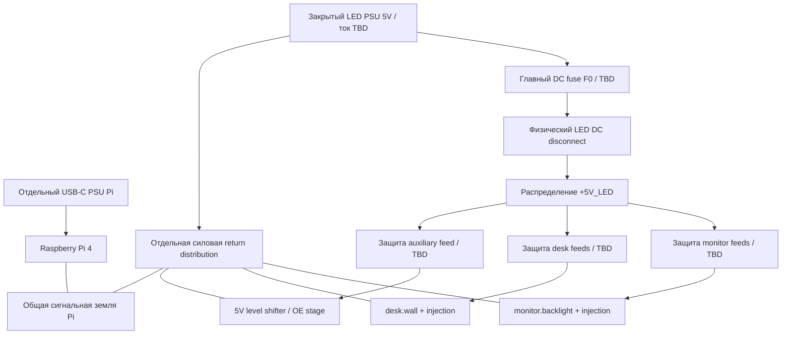

# День 2. Предварительная схема соединений

Статус: **draft для выбора topology и последующего spike**, 25 октября 2026 года. Это не готовая монтажная документация: exact PSU/проводка/fuses, длины, model pinouts и power sequencing пока не подтверждены.

Связи: [BOM](../bom/BOM.md), [расчёт питания](../bom/power-budget.md), [pin map](pin-map.md), [источники](../research/SOURCES.md), [отчёт Д002](../../docs/DAY_002_RESULT.md).

## 1. Варианты управления двумя зонами

| Вариант | Независимость зон | Встроенный 3.5mm audio | Оценка Д002 |
|---|---|---|---|
| A: PWM0 GPIO18 + PWM1 GPIO13 | Две физические DATA линии | По документации выбранного driver конфликт | Не считать основным вариантом полного ТЗ без решения audio conflict |
| B: SPI0, одна цепочка, два logical slices | Независимые mode/color/brightness, общий frame/transport | Документально SPI не занимает PWM audio resource | **Предпочтительный кандидат для spike**, не окончательный ADR |
| C: PCM-based LED | Один физический канал; для двух зон тоже нужен mapping/цепочка | PCM конфликтует с I²S, не с PWM аналоговым audio | Резервный кандидат с проверкой audio graph/driver |
| D: Внешний LED controller | Может дать отдельные DATA outputs | Ресурсы Pi разгружены | Возможное изменение реализации; не добавлять ESP32 в обязательный MVP без решения |

Аппаратные ограничения — из [rpi_ws281x S02](https://github.com/jgarff/rpi_ws281x#limitations). Разделение SPI-chain на две зоны — **проектный вывод**, не готовая возможность, проверенная на этой сборке. Если требование «независимые зоны» подразумевает также раздельную физическую отказоустойчивость, вариант B недостаточен; уточнить Q-002/Q-007 на Д003–Д004.

Вариант A + USB DAC не закрывает отдельное требование встроенного 3.5mm output. Нельзя объявить его выполненным простой заменой выхода без явного изменения ТЗ.

## 2. Topology B: питание



Плюсы `+5V_LED` и `+5V_PI` **не соединяются**. Общая GND нужна сигналам; ток LED возвращается к LED PSU по силовым проводам, не через Pi/sensor harness. Схема показывает DC-часть закрытого PSU, без монтажа сетевого ввода. Количество feeds/fuses уточняется после routing; один знак FM/FD может представлять несколько защищённых leads.

Номиналы F0/FM/FD/FA и connectors пока `TBD`: [методика расчёта](../bom/power-budget.md). Fan питается с Pi-side budget, чтобы выключение LED-питания не лишало Pi охлаждения.

## 3. Topology B: DATA и логические зоны

```text
Pi GPIO10 / physical 19 (SPI0 MOSI, 3.3V)
  -> AHCT buffer input
  -> AHCT output (5V)
  -> R_DATA ~330Ω у первого DIN
  -> monitor.backlight DIN
  -> все LED монитора в согласованном порядке
  -> monitor DOUT
  -> межзонный DATA + signal GND cable
  -> R_DATA2 candidate у desk DIN
  -> desk.wall DIN
  -> последний DOUT не подключён

LED power: отдельные feeds к monitor и desk от одного LED PSU.
DATA не разветвляется Y-кабелем на два DIN.
```

Физическая chain передаёт один frame длины `N_monitor+N_desk`. Renderer формирует каждый slice независимо. OFF monitor означает нулевой RGB его slice при сохранении питания/передачи DATA; это не аппаратный разрыв питания первой зоны.

Компромисс: неисправность первой цепочки или отключение её питания может нарушить передачу ко второй. Это не независимые hardware failure domains. Возвратный DATA cable должен быть физически возможен и проверен. Если трасса длинная/шумная, не обещать работу простого single-ended соединения: пересмотреть расположение или topology до монтажа.

Для RGB 24 bits и условных 800kbit/s оценка чистого времени передачи — `N×24/800000`; плюс reset/latch конкретной ревизии и driver overhead. Для 240/300/360 пикселей это 7.2/9/10.8мс только serial data. Из этого не следует измеренная e2e задержка <100мс или гарантированные 30 FPS. Формат/частоту подтвердить по exact LED datasheet.

## 4. AHCT buffer и startup enable

Кандидат — SN74AHCT125 в **14-pin DIP (N)** либо carrier с такой же подтверждённой схемой. У него VCC=14, GND=7, 1A=2, 1Y=3, active-low 1OE=1. Питание 5V, 3.3V DATA допустим по TTL input threshold. Pin numbers нельзя переносить на иной package без проверки. Источник: [TI S03, pin functions/operating conditions](https://www.ti.com/lit/ds/symlink/sn74ahct125.pdf).

Проектное соединение:

| Узел | Соединение |
|---|---|
| VCC / GND buffer | +5V_LED_AUX / common GND; 100nF у питания |
| 1A | GPIO10; кандидат 100kΩ pull-down на GND |
| 1Y | R_DATA → первый DIN |
| 1OE | 10kΩ pull-up к +5V_LED_AUX: disabled по умолчанию |
| OE enable | NPN/open-collector stage: collector→1OE, emitter→GND |
| NPN base | GPIO25 через кандидат 4.7kΩ; base-emitter pull-down 100kΩ |
| Неиспользуемые каналы | Inputs зафиксировать, OE держать disabled, outputs оставить свободными |

Это **проектная enable-схема**, не готовая плата. GPIO25 не соединяется прямо с OE, подтянутым к 5V. Exact transistor/package/pinout и resistor values подтвердить до пайки. Общая программа разрешает DATA только после инициализации нулевого frame и готовности LED-питания.

**Открытое ограничение power sequencing:** активный DATA от Pi при обесточенном buffer/LED может привести к паразитному питанию. Один OE не решает проблему unpowered input. Для первого стенда подключать при снятом питании и соблюдать определённый порядок включения/выключения; до постоянной установки проверить partial-power behavior и выбрать документированную input isolation/power-good interlock, если независимый hard-off LED возможен при продолжающей работать Pi. Место для такого узла зарезервировано, готовая реализация пока не заявлена. Физический disconnect из ТЗ требует отдельного испытания этого случая.

## 5. I²C sensors

```text
Pi 3.3V / GND -> совместимые 3.3V breakout supply
GPIO2 (pin 3) -> SDA всех трёх устройств
GPIO3 (pin 5) -> SCL всех трёх устройств

VEML7700  0x10        -> illuminance_lux
BME280    0x76/0x77   -> temperature_c, humidity_percent
SGP40     0x59        -> raw VOC -> local algorithm -> voc_index
```

Адреса предварительно не конфликтуют; источники S06–S08 в [реестре](../research/SOURCES.md). BME280 address strap выбирается явно. На готовых модулях проверить VIN vs VDD, regulator drop, pull-up rails и правильный sensor ID. На первой сборке проектная bus speed 100kHz; утверждение по результатам проверки длины/ёмкости/edges.

Pull-ups разных breakout соединяются параллельно. Учесть резисторы Pi, снять избыточные jumpers по schematic конкретной платы, проверить sink current/rise time. Не добавлять произвольные pull-ups к 5V. Sensor grounds/провода не включать последовательно в LED power return.

Temperature/humidity module разместить вне прямого нагрева Pi/PSU; lux sensor не направлять так, чтобы он измерял только собственную LED-ленту. Эти placement choices проверяются калибровкой, а не автоматически считаются правильными.

## 6. PIR, кнопка, CV indicator, fan

- **PIR:** кандидат EKMC1601111 питается от 3.3V, OUT→GPIO27. Вход высокоомный; external pull и breakout проверить по output current. Первые до 30 секунд после подачи питания не трактовать как достоверный motion. Физические выводы PIR сверять по package drawing, а не порядку контактов generic HC-SR501. [Panasonic S09](https://mediap.industry.panasonic.eu/assets/imported/industrial.panasonic.com/cdbs/www-data/pdf/EWA0000/bltn_eng_ekmc160611_ast-ind-247327.pdf).
- **Кнопка:** GPIO17→NO button→GND, input pull-up; debounce и press windows задаются позже. Длинный наружный кабель требует отдельной защиты/фильтрации, а не предположения о свойствах короткого стенда.
- **CV LED:** GPIO22→кандидат 1kΩ→anode LED; cathode→GND. Для условного Vf=2V ток `(3.3−2)/1000≈1.3mA`; проверить фактический Vf/видимость. Более мощный indicator — через отдельный driver. Это видимый индикатор любой CV-активности, не светодиод питания Pi.
- **Fan:** +5V_PI→fan driver/load circuit, управляющий input GPIO16 с документированной совместимостью 3.3V. Не питать мотор от GPIO. Выбор module, защиты от выбросов и default fan state зависит от точного fan и решения Q-004 на Д003/Д007; здесь только зарезервирован interface. Для первоначального охлаждения допустим always-on fan до проверки control stage.

## 7. Камеры и audio

USB UVC webcam подключается к USB, Pi Camera — к CSI, в тестах по отдельности. Capture owner один для gesture/presence; кабель CSI и OS stack выбираются по S10/S11 и фактической камере. Не копировать пример записи изображения из camera documentation: project runtime frames остаются в RAM.

Вариант B оставляет возможность отдельно проверить встроенный analog audio, USB DAC и Bluetooth output. Это отсутствие известного PWM-resource conflict, а не уже доказанная совместная работа всех Bluetooth/audio/DSP modes. USB camera/SSD/DAC могут потребовать отдельного power budget/hub.

## 8. Что проверить на Д004/Д008 до принятия topology

- [ ] Пользовательская независимость зон означает independent state, либо нужны ещё независимые физические линии/отказы.
- [ ] SPI0 захватывается LED driver без других SPI slaves, clock/boot config на целевой Ubuntu повторяемы.
- [ ] Один физический frame даёт два независимых logical modes, разные brightness и общий limiter.
- [ ] Встроенный 3.5mm output работает одновременно с LED, затем проверить USB/Bluetooth.
- [ ] Межзонный кабель доступной длины не вызывает flicker/data errors; проверить grounding и waveform.
- [ ] Начальный frame, OE default и оба порядка включения питания не дают ложных вспышек/backfeed.
- [ ] Physical LED hard-off при работающей Pi проходит без паразитного питания DATA; при необходимости добавить isolation/interlock.
- [ ] Нужные privileges/DMA/driver access согласуются с non-root container constraint либо оформленным решением.
- [ ] Фактические LED FPS/temperature/audio integrity подтверждены измерением.

До выполнения checklist схема остаётся draft; исходное ТЗ не меняется.
